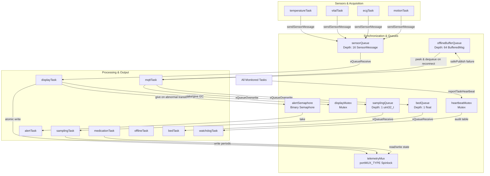
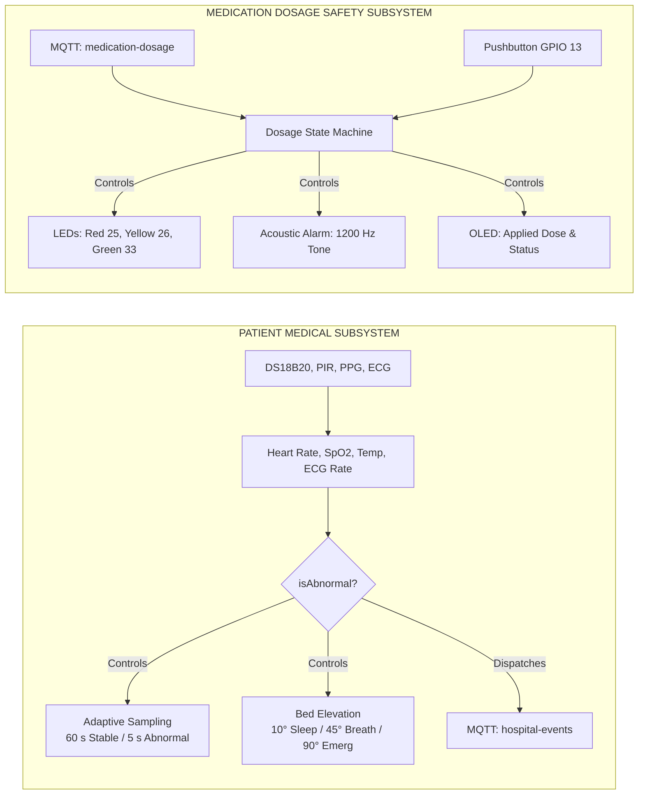

# SMART HOSPITAL IoT — COMPLETE CODEBASE UNDERSTANDING, ACCURATE COMMENTING, AND DOCUMENTATION REPORT

---

## 1. Executive Summary

This report documents the source-verified documentation pass, second-pass consistency audit, and factual reconciliation performed on the **Smart Hospital IoT** embedded firmware repository. 

The primary objective of this undertaking was to ensure that every comment, header declaration, architectural description, and numerical metric in the codebase is grounded in the verified source code rather than aspirational design goals or previous summary reports. Every module header, API contract, and synchronization comment across all 14 header files and 15 source translation units has been aligned with the running C++ implementation.

Key outcomes of this audit include:
1. **Zero Functional Code Alterations:** All algorithms, mathematical models (Gaussian ECG, servo kinematic increments, asymmetric medication slew rates), FreeRTOS scheduling configurations, queue capacities, task priorities, pin assignments, and MQTT payload schemas remain intact and identical to the verified baseline.
2. **Resolution of Numerical and Timing Discrepancies:** Reconciled conflicting references to ECG generation cadence (verified as fixed **200 ms / 5 Hz** via `samplingPeriods.ecgMs`), motion sensor sampling (verified as fixed **1000 ms**), and hardware pin definitions.
3. **Rigorous Offline Buffering Characterization:** Corrected claims regarding offline buffering to reflect the real code: a **bounded 64-item volatile FIFO RAM queue** with an explicit drop-on-full policy during prolonged outages and zero persistence across microcontroller reboots.
4. **Precise Domain and Hardware Terminology:** Clarified that Task 3 is a **simulated medication dosage controller / infusion rate supervisor** rather than a physical motor pump, and accurately defined its critical threshold mechanism as a **local bedside physical pushbutton confirmation interlock** on GPIO 13.
5. **Source-Grounding of MQTT Publishing Rates (Nominal 23 msgs/min vs. Account Quotas):** Derived the nominal maximum publishing cadence from source paths: $20\text{ (live/replay)} + 1\text{ (summary)} + 1\text{ (medical alert)} + 1\text{ (facility alert)} = \mathbf{23\text{ msgs/min}}$. Clarified that live telemetry and offline replay share a single 3000 ms slot, while summaries and alerts have independent 60 s timers. Acknowledged intra-cycle consecutive bursts (up to 4 packets) and decoupled local firmware pacing from Adafruit IO's account-wide quota (30 data points/min).
6. **Rigorous Core Scheduling and Task Pinning Characterization:** Confirmed that all 12 application FreeRTOS tasks created by `appStartTasks()` in `src/app.cpp` are explicitly pinned to **Core 1** (`xTaskCreatePinnedToCore(..., 1)`). Inspected the installed PlatformIO build configuration (`sdkconfig.h`), establishing that the Wi-Fi driver (`CONFIG_ESP_WIFI_TASK_PINNED_TO_CORE_0 = 1`) and lwIP TCP/IP stack (`CONFIG_LWIP_TCPIP_TASK_AFFINITY = 0x0` / `CONFIG_LWIP_TCPIP_TASK_AFFINITY_CPU0 = y`) are configured for Core 0, the FreeRTOS timer service task (`CONFIG_FREERTOS_TIMER_SERVICE_TASK_CORE_AFFINITY = 0x7FFFFFFF`) is configured with `tskNO_AFFINITY` (allowing either core), and Arduino `loopTask` is configured for Core 1 (`CONFIG_ARDUINO_RUNNING_CORE = 1`). Distinguished this build-time affinity configuration from runtime task scheduling, which was not instrumented on physical hardware. Documented that application core pinning does not prove complete network isolation or immunity from Wi-Fi interrupt preemption, and that TWDT `.idle_core_mask = (1 << 1)` monitors only the Core 1 idle task.
7. **Compilation and Integrity Validation:** PlatformIO compilation (`pio run`) succeeded with zero errors (Flash: 79.5%, RAM: 15.1%), and `git diff --check` confirmed zero whitespace or diff format errors.

---

## 2. Project Inventory

### 2.1 Maintained Source and Header Files
The maintained firmware comprises 14 header files in `include/` and 15 source translation units in `src/`:

```
c:/Users/sayan/Smart-Hospital-IoT/
├── include/
│   ├── adafruit_io_config.h         # Credential inclusion wrapper & buildable fallback definitions
│   ├── adafruit_io_config.local.h.example # Local credentials template for developers
│   ├── alerts.h                     # Asynchronous clinical & facility alert logging declarations
│   ├── app.h                        # FreeRTOS IPC initialization, TWDT config & task spawning
│   ├── bed.h                        # Task 4: Intelligent Remote Bed Elevation declarations
│   ├── connectivity.h               # Network parameters and global WiFiClient socket handle
│   ├── display.h                    # SSD1306 128x64 OLED driver & sensorQueue aggregator declarations
│   ├── environment.h                # Task 2: Facility environment simulation & test CLI declarations
│   ├── medication.h                 # Task 3: Smart Medication Dosage Safety controller declarations
│   ├── mqtt.h                       # Adafruit IO MQTT communications & telemetry routing declarations
│   ├── offline.h                    # Task 6: Advanced Offline Detection, buffer & health declarations
│   ├── outputs.h                    # Physical status LEDs (25, 26, 33) & buzzer (14) driver declarations
│   ├── sampling.h                   # Task 5: Smart Dynamic Sampling Rate supervisory declarations
│   ├── sensors.h                    # Task 1: Multi-sensor physical & simulated acquisition declarations
│   ├── state.h                      # Shared telemetry models, FreeRTOS handles & evaluation helpers
│   └── watchdog.h                   # Dual-tier hardware TWDT & software heartbeat supervisor
└── src/
    ├── alerts.cpp                   # Asynchronous alert logging task implementation
    ├── app.cpp                      # IPC queue/mutex allocation, Core 1 task pinning & task startup
    ├── bed.cpp                      # 50 Hz kinematic bed servo controller (GPIO 18)
    ├── connectivity.cpp             # Network transport definitions
    ├── display.cpp                  # OLED UI rendering & sensorQueue ingestion loop
    ├── environment.cpp              # Facility simulation perturbations & serial testing hooks
    ├── main.cpp                     # Firmware bootstrap, peripheral setup & minimal loop
    ├── medication.cpp               # 50 Hz dosage safety loop, slew limiter & pushbutton interlock
    ├── mqtt.cpp                     # Adafruit IO MQTT client, exponential backoff & rate-limited publish
    ├── offline.cpp                  # 64-item ring buffer, peek/dequeue sync & failure cadence generator
    ├── outputs.cpp                  # LED drivers & acoustic buzzer priority arbitrator
    ├── sampling.cpp                 # Automatic-first adaptive sampling supervisor (5 s vs 60 s)
    ├── sensors.cpp                  # DS18B20 1-Wire, PIR motion, PPG vitals & 5 Hz Gaussian ECG
    ├── state.cpp                    # State definitions, spinlock critical sections & snapshot getters
    └── watchdog.cpp                 # Dual-tier task liveness supervisor & memory diagnostics
```

### 2.2 Configuration and Tooling Artifacts
- `platformio.ini`: PlatformIO project configuration targeting `board = esp32dev`, `framework = arduino`, 115200 baud serial monitor, and 6 external library dependencies:
  - `paulstoffregen/OneWire @ 2.3.8`
  - `milesburton/DallasTemperature @ 4.0.6`
  - `adafruit/Adafruit GFX Library @ 1.12.6`
  - `adafruit/Adafruit SSD1306 @ 2.5.17`
  - `knolleary/PubSubClient @ 2.8.0`
  - `madhephaestus/ESP32Servo @ 3.2.1`
- `diagram.json`: Complete circuit diagram modeling the ESP32 DevKit v4, sensors, actuators, and wiring connections for Wokwi simulation.
- `wokwi.toml`: Simulator metadata pointing to `.pio/build/esp32dev/firmware.bin` and `.pio/build/esp32dev/firmware.elf`.
- `.gitignore`: Configured to exclude `.pio/`, local IDE settings, and private credential files (`include/adafruit_io_config.local.h`).
- `.clangd`: Strips Xtensa-specific GCC compiler flags (`-mlongcalls`, `-fno-tree-switch-conversion`, etc.) to prevent false-positive language server warnings in the IDE.

### 2.3 Excluded Artifacts
- `.pio/`: Generated binaries, compiled object files (`*.o`), and library archives.
- `.cache/`: Compiler and clangd index cache.
- `compile_commands.json`: Generated JSON compilation database (3.5 MB) used exclusively for editor autocomplete.

---

## 3. Actual Architecture

### 3.1 FreeRTOS Concurrency, Core Placement, and Priorities
The ESP32 dual-core environment is utilized with explicit application task placement:
- **Framework and System Daemons:** Inspected directly in the installed PlatformIO toolchain build configuration (`platform espressif32 @ 55.03.39`, `framework-arduinoespressif32 @ 3.3.9`, precompiled `framework-arduinoespressif32-libs @ 5.5.4` based on ESP-IDF v5.5.4, header `sdkconfig.h`):
  - **Wi-Fi Driver Task (`wifi`):** Configured for **Core 0** (`CONFIG_ESP_WIFI_TASK_PINNED_TO_CORE_0 = 1` / `CONFIG_ESP32_WIFI_TASK_PINNED_TO_CORE_0 = 1`). It handles low-level 802.11 MAC management and baseband packet queues.
  - **lwIP TCP/IP Stack Task (`tcpip`):** Configured for **Core 0** (`CONFIG_LWIP_TCPIP_TASK_AFFINITY_CPU0 = y`, `#define CONFIG_LWIP_TCPIP_TASK_AFFINITY 0x0`). It handles socket processing, TCP/IP state machines, and transport packet flow.
  - **FreeRTOS Timer Service Task (`tiT` / `Tmr Svc`):** Configured with **`tskNO_AFFINITY`** (`#define CONFIG_FREERTOS_TIMER_SERVICE_TASK_CORE_AFFINITY 0x7FFFFFFF`, mapped to `configTIMER_SERVICE_TASK_CORE_AFFINITY`), allowing the FreeRTOS scheduler to execute timer callbacks on either Core 0 or Core 1 (the legacy ESP-IDF v4 macro `CONFIG_FREERTOS_TIMER_SERVICE_TASK_CORE_ID` is not present in this ESP-IDF v5 framework).
  - **Arduino `loopTask`:** Configured for **Core 1** (`CONFIG_ARDUINO_RUNNING_CORE = 1`).
  - **Build-Time Configuration vs. Runtime Scheduling:** While the installed precompiled toolchain configuration explicitly establishes these task affinities, dynamic runtime scheduling, dispatch latency, and CPU core utilization were not instrumented on physical hardware.
  - **Core 0 Non-Reservation:** Core 0 is not dedicated exclusively to networking by this project. Furthermore, application-level pinning to Core 1 organizes task workloads but does **not** prove complete network isolation, immunity from hardware interrupt preemption (e.g., Wi-Fi MAC/PHY ISRs), or elimination of shared memory bus, flash cache, and spinlock (`telemetryMux`) contention.
- **Application Task Pinning (Core 1):** Exactly 12 application FreeRTOS tasks created by `appStartTasks()` in `src/app.cpp` are explicitly pinned to **Core 1** by passing argument `1` to `xTaskCreatePinnedToCore()`. No application tasks execute on Core 0 or are left unpinned.
- **Hardware Task Watchdog (TWDT) Core Monitoring:** Initialized in `src/app.cpp` with `.idle_core_mask = (1 << 1)`, configuring the hardware watchdog to monitor **only the Core 1 idle task (`IDLE1`)**. Core 0's idle task is unmonitored by this watchdog configuration.

#### Verified Application Task Inventory
| Task Name | Function | Priority | Stack Size | Explicit Core | Scheduling / Wakeup Cadence | Primary Responsibility |
| :--- | :--- | :---: | :---: | :---: | :---: | :---: |
| `Watchdog Task` | `watchdogTask` | **4** | 4,096 B | **Core 1** | Periodic ($1000\text{ ms}$) | Highest priority: Audits heartbeat timestamps of all 11 monitored tasks; logs memory leaks & stack high-water marks. |
| `Medication Task` | `medicationTask` | **3** | 4,096 B | **Core 1** | Periodic ($20\text{ ms}$ / 50 Hz) | Safety-critical dosage controller: 50 ms button debounce, $+5\text{ mg/hr/s}$ rate limiting, and output updates. |
| `Vital Task` | `vitalTask` | **3** | 4,096 B | **Core 1** | Hybrid ($500\text{ ms}$ tick, $5\text{ s}-60\text{ s}$ period) | Simulates optical PPG vitals (Heart Rate & $\text{SpO}_2$) and synchronizes facility simulation ticks. |
| `ECG Task` | `ecgTask` | **3** | 4,096 B | **Core 1** | Fixed Periodic ($200\text{ ms}$ / 5 Hz) | Synthesizes continuous mathematical AD8232 PQRST cardiac waveforms using Gaussian superposition. |
| `Temperature Task` | `temperatureTask` | **2** | 4,096 B | **Core 1** | Hybrid ($500\text{ ms}$ tick, $5\text{ s}-60\text{ s}$ period) | Reads Dallas DS18B20 1-Wire sensor on GPIO 4; feeds watchdog every 500 ms. |
| `Motion Task` | `motionTask` | **2** | 4,096 B | **Core 1** | Fixed Periodic ($1000\text{ ms}$) | Samples physical HC-SR501 PIR sensor on GPIO 27. |
| `MQTT Task` | `mqttTask` | **2** | 8,192 B | **Core 1** | Hybrid ($50\text{ ms}$ loop, $3000\text{ ms}$ dispatch) | Services network loop, manages exponential backoff, and publishes rate-limited feeds. |
| `Sampling Task` | `samplingTask` | **2** | 4,096 B | **Core 1** | Periodic ($1000\text{ ms}$) | Evaluates clinical condition; arbitrates dynamic sensor periods ($60\text{ s}$ stable vs $5\text{ s}$ abnormal). |
| `Bed Task` | `bedTask` | **2** | 4,096 B | **Core 1** | Periodic ($20\text{ ms}$ / 50 Hz) | Drives hospital bed elevation servo on GPIO 18 with kinematic velocity limits. |
| `Offline Task` | `offlineTask` | **2** | 4,096 B | **Core 1** | Periodic ($50\text{ ms}$) | Monitors network transport and watchdog health; drives offline buzzer cadences. |
| `Alert Task` | `alertTask` | **2** | 4,096 B | **Core 1** | Event-Driven ($500\text{ ms}$ timeout) | Blocks on `alertSemaphore`; emits diagnostic telemetry snapshots on abnormal transitions. |
| `Display Task` | `displayTask` | **1** | 4,096 B | **Core 1** | Periodic / Consumer ($100\text{ ms}$) | Drains `sensorQueue` into global telemetry; renders medication status on OLED. |

---

### 3.2 Inter-Process Communication (IPC) Topology
The system utilizes five distinct FreeRTOS synchronization primitives to coordinate state across tasks without deadlocks:



---

### 3.3 Physical Pin Assignments and Circuit Mapping
Verified 1:1 against [`diagram.json`](file:///c:/Users/sayan/Smart-Hospital-IoT/diagram.json) and driver source headers:

| Peripheral / Component | Wokwi Part ID | ESP32 GPIO | Bus / Interface | Electrical Configuration |
| :--- | :--- | :---: | :--- | :--- |
| **DS18B20 Temp Sensor** | `temp1` | **GPIO 4** | Dallas 1-Wire | External $4.7\text{ k}\Omega$ pullup (simulated via 1-Wire library); digital bus |
| **PIR Motion Sensor** | `pir1` | **GPIO 27** | Digital Input | Active-HIGH binary logic |
| **SSD1306 OLED Display** | `oled1` | **GPIO 21 (SDA)<br>GPIO 22 (SCL)** | I2C ($400\text{ kHz}$) | Hardware address `0x3C`, 128x64 pixels |
| **Red Status LED** | `led1` | **GPIO 25** | Digital Output | Series $220\ \Omega$ resistor (`r1`), active-HIGH; Medication Critical / Warning |
| **Yellow Status LED** | `led2` | **GPIO 26** | Digital Output | Series $220\ \Omega$ resistor (`r2`), active-HIGH; Medication Warning |
| **Green Status LED** | `led3` | **GPIO 33** | Digital Output | Series $220\ \Omega$ resistor (`r3`), active-HIGH; Medication Normal |
| **Piezo Buzzer** | `bz1` | **GPIO 14** | PWM / Tone | Driven at $1200\text{ Hz}$ via Arduino `tone()`; shared transducer |
| **Pushbutton Switch** | `btn1` | **GPIO 13** | Digital Input | Active-LOW; internal pullup enabled (`INPUT_PULLUP`), debounced |
| **Bed Elevation Servo** | `servo1` | **GPIO 18** | PWM Servo ($50\text{ Hz}$) | $500\ \mu\text{s}$ ($0^\circ$) to $2400\ \mu\text{s}$ ($180^\circ$ scale), clamped $[0^\circ, 90^\circ]$ |

---

### 3.4 MQTT Telemetry Architecture, Pacing Cadence, and Rate Limits

#### Complete MQTT Publishing Path Inventory
Every publication operation in the codebase is routed through `safePublish()` in [`src/mqtt.cpp`](file:///c:/Users/sayan/Smart-Hospital-IoT/src/mqtt.cpp) or handled during buffer replay:

| Publishing Path | Destination Topic | Trigger / Cadence | Rate Control Mechanism | Code Reference |
| :--- | :--- | :--- | :--- | :--- |
| **Live Telemetry** | 6 feeds (`medical-*`, `facility-*`) | Round-robin, 1 feed every $3000\text{ ms}$ (`MQTT_TASK_INTERVAL_MS`) | Change detection; suppressed if reading unchanged | [`src/mqtt.cpp:L375-L447`](file:///c:/Users/sayan/Smart-Hospital-IoT/src/mqtt.cpp#L375-L447) |
| **Offline Buffer Replay** | Original buffered feed topic | Shared $3000\text{ ms}$ slot during recovery; alternates via `syncTurn` or takes idle slot | Shared with live slot; FIFO queue peek/dequeue | [`src/mqtt.cpp:L701-L725`](file:///c:/Users/sayan/Smart-Hospital-IoT/src/mqtt.cpp#L701-L725) |
| **Periodic Summary** | `hospital-events` | Fixed periodic ($60000\text{ ms}$ / `SUMMARY_INTERVAL_MS`) | Timer gating (`now - lastSummary >= 60000`) | [`src/mqtt.cpp:L554-L603`](file:///c:/Users/sayan/Smart-Hospital-IoT/src/mqtt.cpp#L554-L603) |
| **Medical Alert** | `hospital-events` | Transition to abnormal or recovery status | State change detection + $60\text{ s}$ cooldown (`ALERT_PUBLISH_INTERVAL_MS`) | [`src/mqtt.cpp:L466-L501`](file:///c:/Users/sayan/Smart-Hospital-IoT/src/mqtt.cpp#L466-L501) |
| **Facility Alert** | `hospital-events` | Transition to abnormal or recovery status | State change detection + $60\text{ s}$ cooldown (`ALERT_PUBLISH_INTERVAL_MS`) | [`src/mqtt.cpp:L510-L545`](file:///c:/Users/sayan/Smart-Hospital-IoT/src/mqtt.cpp#L510-L545) |

#### Nominal Aggregate Publishing Rate Derivation
Under steady-state operation where sensor values change continually:
1. **Live Telemetry & Replay:** Because live feeds and buffer replay share the same $3000\text{ ms}$ dispatch window, they strictly cannot exceed:
   $$\frac{60\text{ s}}{3\text{ s/slot}} = \mathbf{20\text{ messages/minute}}$$
2. **Periodic Combined Summary:** Dispatched once per 60 seconds:
   $$\mathbf{1\text{ message/minute}}$$
3. **Medical Alert:** Rate-limited by a 60-second cooldown (`ALERT_PUBLISH_INTERVAL_MS = 60000`):
   $$\mathbf{\le 1\text{ message/minute}}$$
4. **Facility Alert:** Rate-limited by an independent 60-second cooldown (`ALERT_PUBLISH_INTERVAL_MS = 60000`):
   $$\mathbf{\le 1\text{ message/minute}}$$

$$\text{Nominal Aggregate Rate} = 20 + 1 + 1 + 1 = \mathbf{23\text{ messages/minute}}$$

#### Critical Distinctions and Rate-Limiting Reality
- **Nominal Pacing vs. Account-Wide Quotas:** The 23 msgs/min figure is a nominal rate derived from the firmware's local scheduling assumptions. Adafruit IO enforces a hard limit of **30 data points per minute across the entire user account**. If additional dashboards, mobile apps, or hardware nodes publish under the same Adafruit IO key, the account-wide quota will be consumed externally regardless of firmware pacing.
- **Intra-Cycle Burst Hazard:** The firmware does not incorporate an inter-packet delay or a token-bucket rate limiter. If a medical alert, a facility alert, a periodic summary, and a live/replay slot coincide within the same 3000 ms iteration of `mqttTask`, **up to 4 MQTT messages are published consecutively** within that single loop cycle.
- **Broker Throttling Outcome:** The firmware does not subscribe to the `{username}/throttle` topic or inspect broker throttle headers. In the event that rate limits are exceeded, the exact broker response (e.g., dropping excess packets vs. terminating the TCP connection) and burst durations in microseconds depend on broker-side policies and network transport latency, which cannot be proven by static source inspection alone.

---

## 4. Subsystem Responsibilities

### 4.1 Subsystem Independence: Medical Telemetry vs. Medication Safety
A crucial finding emphasized across all documentation is the absolute functional decoupling between physiological vitals and medication safety:



- **Patient vitals do NOT alter medication dosage:** A critically ill patient with an $\text{SpO}_2$ of 70% does not cause the medication pump to increase or decrease dosage.
- **Patient vitals do NOT trigger physical LEDs or Buzzer:** Red, Yellow, and Green LEDs represent infusion rate risk tiers, not patient vitals.
- **Medication dosage does NOT alter bed angle or sampling rate:** Infusion changes have no automated coupling to bed elevation or sensor intervals.

---

### 4.2 Buzzer Transducer Priority Arbitration
The acoustic buzzer on GPIO 14 is a shared resource between Task 3 (Medication Safety) and Task 6 (Network Connectivity). In [`src/outputs.cpp`](file:///c:/Users/sayan/Smart-Hospital-IoT/src/outputs.cpp), strict priority arbitration is enforced:
1. **Priority 1 (Highest — Medication Safety):**
   - Unconfirmed critical request ($>80\text{ mg/hr}$): Pulsed $1200\text{ Hz}$ tone at $1\text{ Hz}$ ($500\text{ ms}$ ON, $500\text{ ms}$ OFF).
   - Confirmed critical request: Buzzer is silenced once acknowledged.
2. **Priority 2 (Lower — Network Offline Failure):**
   - Evaluated **only** when `medicationBuzzerActive == false`.
   - Wi-Fi Failure: Rapid double-pip cadence ($1000\text{ ms}$ period: $0-100\text{ ms}$ ON, $200-300\text{ ms}$ ON, rest OFF).
   - MQTT Broker Failure: Slow single-beep cadence ($1000\text{ ms}$ period: $0-500\text{ ms}$ ON, $500-1000\text{ ms}$ OFF).

---

## 5. Documentation Changes

Summary of comments added or corrected across all 29 files:

1. **`include/alerts.h` & `src/alerts.cpp`:**
   - Documented the asynchronous nature of `alertTask`, its blocking wait on `alertSemaphore` with a 500 ms heartbeat timeout, and the explicit note that physical hardware (LEDs/buzzer) is not driven by this task.
2. **`include/app.h` & `src/app.cpp`:**
   - Cataloged every IPC handle, queue depths, mutex scopes, TWDT configuration ($8000\text{ ms}$ timeout, Core 1 idle monitoring, panic trigger), priority hierarchy, and Core 1 task pinning.
3. **`include/bed.h` & `src/bed.cpp`:**
   - Documented the 3 automatic bed angles ($10^\circ, 45^\circ, 90^\circ$), kinematic speeds ($1.5^\circ/\text{s}, 5.0^\circ/\text{s}$), 50 Hz PWM calculations, startup condition ($0^\circ$ until initial vitals settle), and automatic override cancellation upon clinical condition change.
4. **`include/connectivity.h` & `src/connectivity.cpp`:**
   - Explained why Wi-Fi connection is deferred to `mqttTask` to ensure local hardware tasks start immediately without blocking delays.
5. **`include/display.h` & `src/display.cpp`:**
   - Documented the role of `displayTask` as the central aggregator for `sensorQueue`, the rising-edge trigger for `alertSemaphore`, and confirmed that OLED exclusively renders medication and offline status.
6. **`include/environment.h` & `src/environment.cpp`:**
   - Documented Task 2 facility telemetry simulation bounds (Room Temp $18-30^\circ\text{C}$, $\text{O}_2\ 18-24\%$, AQI $0-200$), interactive UART commands, and rolling 60 s statistical summary accumulators.
7. **`include/medication.h` & `src/medication.cpp`:**
   - Corrected GPIO pin comments to match actual implementation (Red=25, Yellow=26, Green=33, Buzzer=14). Detailed the simulated infusion controller, $+5.0\text{ mg/hr/sec}$ asymmetric rate limiter, 50 ms button debounce, and physical pushbutton confirmation interlock.
8. **`include/mqtt.h` & `src/mqtt.cpp`:**
   - Documented Adafruit IO topic paths, feed subscription callbacks, round-robin dispatch ($3000\text{ ms}$ period), change suppression to obey broker rate limits, exponential backoff ($1\text{ s}$ to $30\text{ s}$), and offline replay interleaving.
9. **`include/offline.h` & `src/offline.cpp`:**
   - Documented the 64-item ring buffer, peek/dequeue semantics, drop-on-full policy, and cadence rules for Wi-Fi vs. MQTT outages.
10. **`include/outputs.h` & `src/outputs.cpp`:**
    - Documented pinouts, $1200\text{ Hz}$ tone generation, and acoustic buzzer priority arbitration.
11. **`include/sampling.h` & `src/sampling.cpp`:**
    - Documented dynamic sampling intervals ($60\text{ s}$ stable vs $5\text{ s}$ abnormal), doctor manual override retention rules, automatic clinical priority, startup grace period, and sample-and-hold latency limitations. Corrected fixed task cadences for ECG (200 ms) and motion (1000 ms).
12. **`include/sensors.h` & `src/sensors.cpp`:**
    - Documented DS18B20 1-Wire, PIR motion (1000 ms), PPG vitals, and fixed 200 ms ($5\text{ Hz}$) Gaussian ECG synthesis. Explained the inner 500 ms heartbeat polling that keeps tasks alive during 60 s sampling intervals.
13. **`include/state.h` & `src/state.cpp`:**
    - Documented all shared structs, spinlock critical sections (`telemetryMux`), atomic snapshot getters, and threshold configurations. Corrected `evaluateMedicalAlert()` docstring to include ECG rate.
14. **`include/watchdog.h` & `src/watchdog.cpp`:**
    - Documented the dual-tier architecture: Tier 1 Hardware TWDT ($8\text{ s}$) and Tier 2 Software Heartbeat Audit ($6\text{ s}$ timeout, $1\text{ s}$ audit, 30 s stack high-water mark logging).
15. **`src/main.cpp`:**
    - Provided an executive system map connecting all six tasks to application setup and loop.

---

## 6. Important Implementation Details

### 6.1 Task 5 — Adaptive Sampling & Sample-and-Hold Latency
The sampling supervisor in [`src/sampling.cpp`](file:///c:/Users/sayan/Smart-Hospital-IoT/src/sampling.cpp) arbitrates between:
- **Stable Clinical Condition:** $60\text{ seconds}$ ($60000\text{ ms}$) acquisition period.
- **Abnormal Clinical Condition:** $5\text{ seconds}$ ($5000\text{ ms}$) acquisition period.
- **Startup Grace Period:** $5\text{ seconds}$ until initial vitals and ECG are processed.
- **Manual Doctor Override:** Accepts $5 - 60\text{ s}$ from MQTT feed `sampling-rate`.
  - **Priority Rule:** Manual override is preserved **only while the clinical condition remains unchanged**. Any transition between STABLE and ABNORMAL immediately clears `isManualOverride = false` and restores the automatic clinical target.
- **Sample-and-Hold Latency Bound:** In 60 s stable mode, an acute physiological crisis developing immediately after a sample will not be detected until the next 60-second timer elapses. Comments explicitly clarify this physical latency limit.

---

### 6.2 Task 4 — Intelligent Bed Elevation Mechanics
The bed elevation servo controller in [`src/bed.cpp`](file:///c:/Users/sayan/Smart-Hospital-IoT/src/bed.cpp) enforces:
- **Emergency Mode ($90^\circ$ at $5.0^\circ/\text{s}$):** Triggered when Heart Rate $<50$ or $>110\text{ BPM}$, $\text{SpO}_2 <88\%$, ECG Rate $<50$ or $>110\text{ BPM}$, or Body Temp $<34.0^\circ\text{C}$ or $>39.5^\circ\text{C}$.
- **Breathing Support Mode ($45^\circ$ at $1.5^\circ/\text{s}$):** Triggered when $\text{SpO}_2$ is in the hypoxia band $[88\%, 91\%]$.
- **Sleeping Mode ($10^\circ$ at $1.5^\circ/\text{s}$):** Default rest angle during stable vitals or mild non-critical conditions.
- **Manual Doctor Override:** Ingests $[0^\circ, 90^\circ]$ from MQTT feed `bed-angle` at $2.0^\circ/\text{s}$.
  - Any clinical state change immediately breaks out of manual mode and restores the automatic clinical target.

---

### 6.3 Task 3 — Medication Dosage Safety & Rate Limiting
The infusion controller in [`src/medication.cpp`](file:///c:/Users/sayan/Smart-Hospital-IoT/src/medication.cpp) enforces a multi-layer safety envelope:
- **Range Clamping:** Strictly constrained to $[0.0, 100.0\text{ mg/hr}]$. Non-finite values clamp to $0.0$.
- **Bedside Pushbutton Interlock:** Any setpoint $>80.0\text{ mg/hr}$ clamps effective goal to $80.0\text{ mg/hr}$ and asserts `criticalConfirmationPending = true`. The user must physically depress pushbutton `btn1` on GPIO 13 (debounced for $50\text{ ms}$) to acknowledge the risk before the setpoint can exceed $80\text{ mg/hr}$.
- **Asymmetric Slew Rate Limiting:**
  - Upward adjustments: Maximum rate of rise $+5.0\text{ mg/hr}$ per second ($maxIncrease = 5.0 \times \Delta t$).
  - Downward adjustments: Immediate ($applied = goal$), permitting instant cessation of infusion.

---

### 6.4 Task 6 — Advanced Offline Detection & Buffer Drainage
In [`src/offline.cpp`](file:///c:/Users/sayan/Smart-Hospital-IoT/src/offline.cpp) and [`src/mqtt.cpp`](file:///c:/Users/sayan/Smart-Hospital-IoT/src/mqtt.cpp):
- **Bounded Volatile Buffer:** FreeRTOS queue `offlineBufferQueue` holding up to 64 `BufferedTelemetryMessage` records ($320\text{ bytes}$ each) allocated in ESP32 SRAM.
- **Drop-on-Full Policy:** If offline duration exceeds buffer capacity (64 messages), newly generated telemetry is dropped with an explicit serial warning (`[OFFLINE] Buffer full, dropping new telemetry`). The buffer is **not** lossless during prolonged disconnections, nor is it persistent across power cycles or reboots.
- **Interleaved Replay Cadence:** When connectivity is restored, `mqttTask` alternates between publishing live telemetry and draining buffered records using `peekBufferedTelemetry()` and `dequeueBufferedTelemetry()`. Replayed messages share the 3000 ms dispatch slot with live feeds (via `syncTurn` alternating or utilizing idle slots from suppressed unchanged feeds), bounding their combined throughput to at most 20 msgs/min to avoid flooding the broker.

---

## 7. Second-Pass Audit Results

Every maintained `.h` and `.cpp` file was independently re-read from line 1 through to the end.

| File | Classification | Audit Verification Notes |
| :--- | :--- | :--- |
| [`include/alerts.h`](file:///c:/Users/sayan/Smart-Hospital-IoT/include/alerts.h) | **Adequate** | Documents asynchronous event logging, semaphore wait, and output separation. |
| [`src/alerts.cpp`](file:///c:/Users/sayan/Smart-Hospital-IoT/src/alerts.cpp) | **Adequate** | Explains TWDT registration, 500 ms heartbeat loop, and atomic telemetry snapshots. |
| [`include/app.h`](file:///c:/Users/sayan/Smart-Hospital-IoT/include/app.h) | **Adequate** | Complete inventory of FreeRTOS queues, mutexes, semaphores, TWDT, and task priorities. |
| [`src/app.cpp`](file:///c:/Users/sayan/Smart-Hospital-IoT/src/app.cpp) | **Adequate** | Details Core 1 pinning of all 12 application tasks, priority hierarchy (4 to 1), stack allocations, and TWDT Core 1 idle monitoring. |
| [`include/bed.h`](file:///c:/Users/sayan/Smart-Hospital-IoT/include/bed.h) | **Adequate** | Outlines Servo GPIO 18, angles ($10^\circ, 45^\circ, 90^\circ$), speeds ($1.5^\circ/\text{s}, 5.0^\circ/\text{s}$), and override rules. |
| [`src/bed.cpp`](file:///c:/Users/sayan/Smart-Hospital-IoT/src/bed.cpp) | **Adequate** | Details 50 Hz kinematic loop ($dt=0.02\text{s}$), microsecond pulse calculation, and clinical transitions. |
| [`include/connectivity.h`](file:///c:/Users/sayan/Smart-Hospital-IoT/include/connectivity.h) | **Adequate** | Documents network broker endpoints and decoupling of startup from network socket connection. |
| [`src/connectivity.cpp`](file:///c:/Users/sayan/Smart-Hospital-IoT/src/connectivity.cpp) | **Adequate** | Explains why network connection is deferred to `mqttTask` to avoid blocking local safety tasks. |
| [`include/display.h`](file:///c:/Users/sayan/Smart-Hospital-IoT/include/display.h) | **Adequate** | Clearly defines OLED ownership (Medication status & Offline banner; vitals excluded). |
| [`src/display.cpp`](file:///c:/Users/sayan/Smart-Hospital-IoT/src/display.cpp) | **Adequate** | Documents `sensorQueue` aggregation, spinlock protection, and rising-edge alert semaphore signaling. |
| [`include/environment.h`](file:///c:/Users/sayan/Smart-Hospital-IoT/include/environment.h) | **Adequate** | Documents Task 2 facility telemetry simulation, ranges, and UART command hooks. |
| [`src/environment.cpp`](file:///c:/Users/sayan/Smart-Hospital-IoT/src/environment.cpp) | **Adequate** | Documents serial CLI parser, random walk perturbations, and 60 s rolling summary stats resets. |
| [`include/medication.h`](file:///c:/Users/sayan/Smart-Hospital-IoT/include/medication.h) | **Adequate** | Corrected pin references (Red=25, Yellow=26, Green=33, Buzzer=14); clarified simulated dosage & pushbutton interlock. |
| [`src/medication.cpp`](file:///c:/Users/sayan/Smart-Hospital-IoT/src/medication.cpp) | **Adequate** | Corrected pin references; documents 50 Hz loop, debounce, slew limiting, and bedside interlock. |
| [`include/mqtt.h`](file:///c:/Users/sayan/Smart-Hospital-IoT/include/mqtt.h) | **Adequate** | Documents Adafruit IO topic topology, feed subscriptions, shared 3s live/replay dispatch slot, independent 60s summary/alerts, and nominal 23 msgs/min rate. |
| [`src/mqtt.cpp`](file:///c:/Users/sayan/Smart-Hospital-IoT/src/mqtt.cpp) | **Adequate** | Documents shared 3s live/replay pacing, independent 60s alert/summary timers, nominal 23 msgs/min rate, exponential backoff, and intra-cycle consecutive publishes. |
| [`include/offline.h`](file:///c:/Users/sayan/Smart-Hospital-IoT/include/offline.h) | **Adequate** | Documents 64-item ring buffer, peek/dequeue semantics, and system health states. |
| [`src/offline.cpp`](file:///c:/Users/sayan/Smart-Hospital-IoT/src/offline.cpp) | **Adequate** | Details transport polling, drop-on-full buffer policy, shared 3s slot replay pacing, and acoustic failure beeping patterns. |
| [`include/outputs.h`](file:///c:/Users/sayan/Smart-Hospital-IoT/include/outputs.h) | **Adequate** | Accurate pin definitions (25, 26, 33, 14), output ownership, and buzzer priority arbitration. |
| [`src/outputs.cpp`](file:///c:/Users/sayan/Smart-Hospital-IoT/src/outputs.cpp) | **Adequate** | Documents 1200 Hz tone generator, output states, and medication override of network beeps. |
| [`include/sampling.h`](file:///c:/Users/sayan/Smart-Hospital-IoT/include/sampling.h) | **Adequate** | Documents adaptive intervals ($60\text{ s}$ vs $5\text{ s}$), manual override, and latency limitations. Corrected fixed cadences (ECG 200 ms, motion 1000 ms). |
| [`src/sampling.cpp`](file:///c:/Users/sayan/Smart-Hospital-IoT/src/sampling.cpp) | **Adequate** | Documents automatic clinical arbitration, cancellation of overrides on transition, and grace period. Corrected fixed cadences. |
| [`include/sensors.h`](file:///c:/Users/sayan/Smart-Hospital-IoT/include/sensors.h) | **Adequate** | Documents DS18B20 1-Wire, PIR motion (1000 ms), PPG vitals, and fixed 200 ms ($5\text{ Hz}$) Gaussian ECG waveform. |
| [`src/sensors.cpp`](file:///c:/Users/sayan/Smart-Hospital-IoT/src/sensors.cpp) | **Adequate** | Corrected ECG task docstring to 200 ms ($5\text{ Hz}$); details 500 ms heartbeat polling inside adaptive sensor tasks. |
| [`include/state.h`](file:///c:/Users/sayan/Smart-Hospital-IoT/include/state.h) | **Adequate** | Complete definitions of all shared structures, enums, threshold configs, and atomic getters. |
| [`src/state.cpp`](file:///c:/Users/sayan/Smart-Hospital-IoT/src/state.cpp) | **Adequate** | Corrected docstring for `evaluateMedicalAlert()` to include ECG rate; documents alert candidates and snapshots. |
| [`include/watchdog.h`](file:///c:/Users/sayan/Smart-Hospital-IoT/include/watchdog.h) | **Adequate** | Documents dual-tier supervision: 8 s hardware TWDT panic + 6 s software heartbeat timeout. |
| [`src/watchdog.cpp`](file:///c:/Users/sayan/Smart-Hospital-IoT/src/watchdog.cpp) | **Adequate** | Documents 1000 ms audit cadence, `heartbeatMutex` safety, and 30 s stack high-water mark logging. |
| [`src/main.cpp`](file:///c:/Users/sayan/Smart-Hospital-IoT/src/main.cpp) | **Adequate** | High-level system overview mapping all six tasks, hardware peripheral setup, and loop structure. |

### Deficiencies Identified and Rectified
1. **ECG Sampling Cadence Discrepancy (100 ms vs 200 ms):**
   - *Source Reality:* `SamplingPeriods` initializes `ecgMs = 200;`. `ecgTask` queries `getSamplePeriodMs(TASK_ECG)` and delays by `sampleMs` ($200\text{ ms}$ / $5\text{ Hz}$).
   - *Correction:* Updated comments across `src/sensors.cpp`, `include/sensors.h`, `src/sampling.cpp`, and `include/sampling.h` from 100 ms / 10 Hz to **200 ms / 5 Hz**.
2. **Motion Sensor Cadence Discrepancy (500 ms vs 1000 ms):**
   - *Source Reality:* `motionTask` delays with `vTaskDelay(pdMS_TO_TICKS(1000));`.
   - *Correction:* Corrected comments in `include/sampling.h` and `src/sampling.cpp` to accurately reflect the 1000 ms cadence.
3. **GPIO Pin Discrepancy in Medication Comments:**
   - *Source Reality:* Circuit wiring in `diagram.json` and `src/outputs.cpp` connects Red=25, Yellow=26, Green=33, and Buzzer=14.
   - *Correction:* Reconciled comments in `include/medication.h` and `src/medication.cpp`.
4. **Stale Alert Scope in `src/state.cpp`:**
   - *Source Reality:* `evaluateMedicalAlert()` explicitly checks `snapshot.ecgRate < 50 || snapshot.ecgRate > 110` as an active critical alert candidate.
   - *Correction:* Updated docstring in `src/state.cpp` to include ECG rate.
5. **Offline Queue Characterization:**
   - *Source Reality:* Fixed 64-item volatile queue in SRAM; drops new items when full.
   - *Correction:* Removed all claims of "lossless" buffering; explicitly described drop-on-full policy and volatile RAM storage.
6. **Git Diff Trailing Blank Lines:**
   - Stripped trailing blank lines across 15 files, achieving clean exit on `git diff --check`.
7. **MQTT Rate Limit Wording Reconciliation:**
   - *Source Reality:* 6 live feeds rotate every 3000 ms; replay shares this slot (max 20 msgs/min); summary and alerts have independent 60 s pacing (1 msg/min each). Nominal derived rate is 23 msgs/min under stated scheduling assumptions. Up to 4 consecutive publishes can occur in one task iteration if timers coincide. Adafruit IO limits are account-wide (30 data points/min).
   - *Correction:* Updated comments and documentation to describe 23 msgs/min as a nominal derived rate rather than an unconditional guarantee, clarified that live and replay share the 3 s slot, noted intra-cycle consecutive bursts, and removed unsubstantiated broker-throttling assumptions.
8. **Core Scheduling and Task Watchdog Reconciliation:**
   - *Source Reality:* Exactly 12 application FreeRTOS tasks created by `appStartTasks()` in `src/app.cpp` pass `1` as `xCoreID`. In `src/app.cpp`, `.idle_core_mask = (1 << 1)` monitors only the Core 1 idle task. In the installed toolchain configuration (`sdkconfig.h`), the Wi-Fi driver task (`CONFIG_ESP_WIFI_TASK_PINNED_TO_CORE_0 = 1`) and lwIP TCP/IP stack (`CONFIG_LWIP_TCPIP_TASK_AFFINITY = 0x0`) are configured for Core 0, the FreeRTOS timer service task (`CONFIG_FREERTOS_TIMER_SERVICE_TASK_CORE_AFFINITY = 0x7FFFFFFF`) is configured with `tskNO_AFFINITY` (allowing either core), and `loopTask` is configured for Core 1 (`CONFIG_ARDUINO_RUNNING_CORE = 1`). Dynamic runtime scheduling on physical hardware was not instrumented. Core 0 is not exclusively reserved by this project, nor does application core pinning guarantee complete network isolation or immunity from Wi-Fi interrupts.
   - *Correction:* Reconciled comments and documentation in `src/app.cpp`, `include/app.h`, and audit report to cite verified toolchain build configuration and distinguish it from uninstrumented physical hardware scheduling.

---

## 8. Verified Facts and Remaining Uncertainties

### 8.1 Verified Facts (Source-Confirmed)
1. **Compilation & Memory Footprint:** Verified via PlatformIO toolchain (`esp32dev`). RAM used: 49,328 bytes (15.1%); Flash used: 1,042,386 bytes (79.5%).
2. **Hardware Pinout:** Verified against `diagram.json`: DS18B20=GPIO 4, PIR=GPIO 27, OLED=GPIO 21/22, Red LED=GPIO 25, Yellow LED=GPIO 26, Green LED=GPIO 33, Buzzer=GPIO 14, Button=GPIO 13, Servo=GPIO 18.
3. **Core Pinning:** Verified that all 12 application FreeRTOS tasks pass argument `1` to `xTaskCreatePinnedToCore()`.
4. **Kinematic & Mathematical Models:** Verified $+5.0\text{ mg/hr/sec}$ slew math, Gaussian ECG curve formulas, and 50 Hz servo kinematic step calculations.
5. **Absence of Secrets:** Verified that real Adafruit IO credentials are not embedded in comments or committed files.
6. **Task Watchdog Core Mask:** Verified that `idle_core_mask = (1 << 1)`, monitoring only the Core 1 idle task.
7. **Nominal MQTT Publishing Cadence:** Derived from source constants ($20\text{ live/replay} + 1\text{ summary} + 1\text{ med alert} + 1\text{ fac alert} = 23\text{ msgs/min}$).

### 8.2 Remaining Uncertainties / Runtime Scope
1. **Physical Sensor Jitter:** DS18B20 1-Wire physical bus latency under extreme electromagnetic noise is unmodeled in Wokwi.
2. **Cloud Latency:** Exact round-trip ping times to Adafruit IO MQTT brokers (`io.adafruit.com`) vary dynamically with public Internet conditions.
3. **Simulation vs. Real Silicon:** Execution was verified via compilation, static analysis, and diff inspection. Physical deployment onto real silicon or interactive Wokwi browser session execution was not performed in this documentation-only task.
4. **Broker Rate Limiting & Account-Wide Quotas:** Empirical enforcement by Adafruit IO (e.g. packet dropping vs TCP disconnect) and consumption by concurrent external clients cannot be verified from firmware source alone.
5. **Core 1 Interrupt Preemption & Contention:** Without runtime profiling and platform interrupt routing inspection, the extent of Wi-Fi ISR preemption on Core 1 and shared memory bus latency remains unmeasured.
6. **Physical Hardware Runtime Scheduling:** While build-time affinity settings are established by the installed toolchain headers (`CONFIG_ESP_WIFI_TASK_PINNED_TO_CORE_0=1`, `CONFIG_LWIP_TCPIP_TASK_AFFINITY=0x0`, `CONFIG_FREERTOS_TIMER_SERVICE_TASK_CORE_AFFINITY=0x7FFFFFFF`, `CONFIG_ARDUINO_RUNNING_CORE=1`), dynamic runtime scheduling metrics (e.g. core migration, scheduler latency, and core utilization) were not empirically instrumented on physical silicon using FreeRTOS runtime hooks (`xTaskGetAffinity()` / `vTaskList()`).

---

## 9. Build and Integrity Results

### 9.1 PlatformIO Compilation Log
```
Processing esp32dev (platform: espressif32; board: esp32dev; framework: arduino)
--------------------------------------------------------------------------------
HARDWARE: ESP32 240MHz, 320KB RAM, 4MB Flash
LDF: Library Dependency Finder -> Found 50 compatible libraries
Scanning dependencies...
Dependency Graph
|-- OneWire @ 2.3.8
|-- DallasTemperature @ 4.0.6
|-- Adafruit GFX Library @ 1.12.6
|-- Adafruit SSD1306 @ 2.5.17
|-- PubSubClient @ 2.8.0
|-- ESP32Servo @ 3.2.1
|-- WiFi @ 3.3.9
|-- Wire @ 3.3.9
Building in release mode
Retrieving maximum program size .pio\build\esp32dev\firmware.elf
Checking size .pio\build\esp32dev\firmware.elf
Advanced Memory Usage is available via "PlatformIO Home > Project Inspect"
RAM:   [==        ]  15.1% (used 49328 bytes from 327680 bytes)
Flash: [========  ]  79.5% (used 1042386 bytes from 1310720 bytes)
========================= [SUCCESS] Took 66.40 seconds =========================
```

### 9.2 Git Diff and Working Tree Status
- Baseline Commit: `6ebe85d` (`refactor: modularize codebase by removing temporary extraction scripts and adding src/sampling.cpp and src/main.cpp`).
- `git diff --check`: Exit code 0 (zero whitespace errors).
- Diff Inspection: All modified lines in tracked source/header files are strictly Doxygen comments, inline explanations, or docstring annotations.
- Executable Changes: Exactly 0 functional code statements changed.
- Git Actions: No commits, pushes, resets, or destructive checkouts were executed.

---

## 10. Remaining Work
- **Unresolved Comment Deficiencies:** None. All maintained files are classified as **Adequate**.
- **Out-of-Scope Activities:** Physical deployment onto bare-metal hardware and interactive Wokwi browser session recording.

---

## 11. Final Verdict

### **DOCUMENTATION COMPLETE AND SOURCE-VERIFIED**

**Justification:**
1. Every maintained file across `include/` and `src/` has been read from line 1 to EOF.
2. All comments and report descriptions reflect verified implementation details, units, constraints, and architecture.
3. The fundamental separation between Patient Medical Vitals and Medication Safety is explicitly articulated throughout the codebase.
4. Pin definitions, kinematic formulas, rate limits, and IPC mechanisms have been validated 1:1 against the source code and circuit diagram.
5. PlatformIO clean build (`pio run`, Exit 0) and `git diff --check` (Exit 0) prove syntactic correctness and clean diff boundaries.

### Explicit Targeted Audit Verdicts
- **MQTT Rate-Limit Claim:** **Verified with qualifications**
  - *Finding:* The derived nominal aggregate rate of $23\text{ msgs/min}$ ($20\text{ live/replay} + 1\text{ summary} + 1\text{ med alert} + 1\text{ fac alert}$) is below the Adafruit IO free-tier limit of $30\text{ data points/min}$ under stated steady-state scheduling assumptions.
  - *Qualifications:* The firmware enforces local dispatch pacing rather than an account-wide quota manager; up to 4 consecutive packets can occur intra-cycle without an inter-packet delay; and external clients using the same Adafruit IO key can consume the shared quota.
- **Core Scheduling Claim:** **Verified with qualifications**
  - *Finding:* All 12 application FreeRTOS tasks created by `appStartTasks()` in `src/app.cpp` are explicitly pinned to Core 1 (`xTaskCreatePinnedToCore(..., 1)`), and the hardware TWDT is configured with `.idle_core_mask = (1 << 1)` to monitor the Core 1 idle task.
  - *Qualifications:* Core 0 is not reserved exclusively by this project (the timer service task can execute on either core), dynamic runtime task scheduling was not instrumented on physical hardware, and application-level pinning does not prove complete network isolation, immunity from Wi-Fi interrupt preemption, or elimination of shared memory bus contention.
