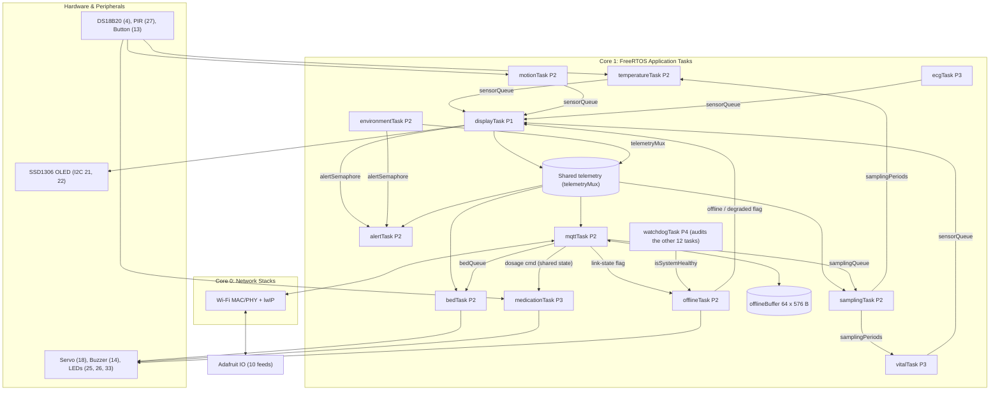

# Smart Hospital IoT System — ESP32 & FreeRTOS

[](https://www.espressif.com/)
[](https://github.com/espressif/arduino-esp32)
[](https://platformio.org/)
[](https://wokwi.com/projects/481027748143740929)
[](LICENSE)
[](https://github.com/iamsayanghosh/Smart-Hospital-IoT/blob/main/docs/Smart_Hospital_IoT_Project_Report.pdf)

A concurrent medical telemetry and facility management firmware prototype implemented on the ESP32 microcontroller using the Arduino framework and FreeRTOS SMP.

* **Live Wokwi Simulation:** [wokwi.com/projects/481027748143740929](https://wokwi.com/projects/481027748143740929)
* **GitHub Repository:** [github.com/iamsayanghosh/Smart-Hospital-IoT](https://github.com/iamsayanghosh/Smart-Hospital-IoT)
* **Target Hardware:** Espressif ESP32 DevKit v4 (Dual-Core Xtensa 240 MHz, 320 KB SRAM)
* **Project Report (PDF):** [Smart_Hospital_IoT_Project_Report.pdf](https://github.com/iamsayanghosh/Smart-Hospital-IoT/blob/main/docs/Smart_Hospital_IoT_Project_Report.pdf)
* **System Architecture Blueprint:** [system_architecture.svg](https://github.com/iamsayanghosh/Smart-Hospital-IoT/blob/main/docs/diagrams/system_architecture.svg) | [PNG](https://github.com/iamsayanghosh/Smart-Hospital-IoT/blob/main/docs/diagrams/system_architecture.png)
* **System Workflow Diagram:** [workflow_block_diagram.svg](https://github.com/iamsayanghosh/Smart-Hospital-IoT/blob/main/docs/diagrams/workflow_block_diagram.svg) | [PNG](https://github.com/iamsayanghosh/Smart-Hospital-IoT/blob/main/docs/diagrams/workflow_block_diagram.png)

> **Disclaimer:** This project is an embedded systems engineering prototype and educational simulation developed for academic and technical evaluation. It is not a certified medical device and must not be used for actual clinical diagnosis, life support, or operational medical administration.

---

## 1. System Architecture & Concurrency Model

All 13 application worker tasks are pinned to **Core 1**, alongside Arduino `loopTask`. Wi-Fi and lwIP networking tasks are configured for **Core 0**, while other system tasks execute according to their configured affinity.

### FreeRTOS Subsystem & Data Pipeline


---

## 2. Assignment Task Implementation

### Task 1: Multi-Sensor Expansion Using FreeRTOS
* **Physical Temperature:** Dallas DS18B20 on 1-Wire bus (`GPIO 4`). Non-blocking state machine (`TEMP_IDLE` $\rightarrow$ `TEMP_CONVERTING`) with an 800–900 ms completion window (800 ms conversion gate plus 100 ms polling cadence) ensures thermal conversion never blocks the scheduler. Filters power-on scratchpad reading (+85.0°C) and invalidates telemetry if sensor resets mid-operation. Maintains a 3-state hardware health model (`UNKNOWN`, `HEALTHY`, `FAULT`); CLI simulated values provide measurement availability for testing without clearing active physical hardware faults.
* **Physical Motion:** HC-SR501 PIR sensor on `GPIO 27`, powered from 5V (`esp:5V`) in circuit diagram to ensure reliable operation of the module's onboard 3.3V LDO regulator on physical hardware.
* **Simulated Photoplethysmogram (PPG):** Optical Heart Rate and $\text{SpO}_2$ autonomous synthesis (nominal baseline 68–80 BPM, 95–98% $\text{SpO}_2$) evaluated against clinical safety thresholds (`50 - 100 BPM` and `92 - 100 %`), with UART overrides (`SET_HR 40-140`, `SET_SPO2 80-100`) for anomalous scenarios.
* **Simulated Electrocardiogram (ECG):** Illustrative real-time Gaussian superposition model synthesizing coarse cardiac cycle morphology at 5 Hz (200 ms cadence) for IoT demonstration (clinical diagnostic ECG requires $\ge 250\text{ Hz}$).
* **Supervision:** Dual-tier watchdog coupling ESP-IDF Task Watchdog Timer (TWDT, 8000 ms) with an application heartbeat auditor (`watchdogTask`, 6000 ms).

### Task 2: Dual-Role Cloud IoT Monitoring (Role-Based Dashboards)
* **Medical Staff Telemetry:** `medical-heart-rate`, `medical-spo2`, `medical-body-temperature`.
* **Facility Management Telemetry:** `facility-room-temperature`, `facility-oxygen`, `facility-aqi`.
* **Consolidated Events & Summaries:** `hospital-events` receives real-time medical/facility alerts (evaluating $\text{SpO}_2 \rightarrow \text{HR} \rightarrow \text{ECG} \rightarrow \text{Temp}$) and an aggregated 60-second summary report distinguishing `NORMAL`, `WARNING`, and `CRITICAL` statuses.

### Task 3: Simulated Medication Infusion Safety System
* **Educational Demonstration:** The firmware models a rate-limited infusion dosage controller with physical safety interlocks (demonstrates software-in-the-loop safety and verification; physical delivery actuators/pumps are not part of the hardware BOM).
* **Infusion Rate Bounds:** 0.0 to 100.0 mg/hr commanded remotely via `medication-dosage`.
* **Safety Tiers:**
  * **Normal (0.0 - 79.9 mg/hr):** Solid Green LED (`GPIO 33`).
  * **Warning (80.0 mg/hr):** Solid Yellow LED (`GPIO 26`).
  * **Critical (> 80.0 mg/hr):** Red LED (`GPIO 25`) and Piezo Buzzer (`GPIO 14`) rapidly blink/beep at ~3.3 Hz (300 ms period: 150 ms ON / 150 ms OFF) while unconfirmed. Dosage is clamped at 80.0 mg/hr until physically confirmed; once confirmed, the Red LED remains solid ON and the buzzer is silenced.
* **Dual-Channel Physical Bedside Interlock:** Clinician must physically press the button on `GPIO 13` to unlock dosages above 80 mg/hr. *Range Authorization Policy:* Once confirmed at bedside for a critical rate, adjustments within the critical band (>80.0 mg/hr) remain authorized without re-prompting; dropping dosage back to $\le 80.0\text{ mg/hr}$ automatically clears confirmation and re-arms the interlock.
* **Asymmetric Slew Limiter:** Increases are smoothly capped to $+5\text{ mg/hr/s}$ across 50 Hz task cycles (with first-step jump elimination and long task interruption recovery) to prevent bolus shock; reductions apply instantaneously.
* **Permanent OLED Display:** The 128x64 OLED display permanently shows current dosage, status, and confirmation cues online and offline.

### Task 4: Intelligent Remote Bed Elevation
* **Actuation:** SG90 Servo on `GPIO 18` with kinematic ramp smoothing (1.5°/s, 2.0°/s, 5.0°/s). Starts at 0° supine on boot until initial vitals are processed. During boot failure rollback (`failSetup()`), the servo PWM timer is explicitly detached.
* **Predefined Clinical Modes:**
  * **Sleeping Rest (10°):** Normal baseline physiological status.
  * **Breathing Support (45°):** Semi-Fowler's positioning automatically triggered by hypoxia ($\text{SpO}_2 \in [88\%, 91\%]$).
  * **Emergency (90°):** Resuscitation positioning triggered by critical vitals ($\text{SpO}_2 < 88\%$, $\text{HR} < 45$ or $> 120\text{ BPM}$, $\text{ECG} < 45$ or $> 120\text{ BPM}$, extreme body temperature $<34.0^\circ\text{C}$ or $>39.5^\circ\text{C}$). Latched across temperature sensor disconnects.
* **Clinician-in-the-Loop Override Primacy:** Clinicians can command angles ($0 - 90^\circ$) via `bed-angle` with full medical override authority—including commanding $0^\circ$ flat supine during an active cardiac arrest for CPR chest compressions. Any subsequent transition in the patient's bed posture category (`SLEEPING` ↔ `BREATHING_SUPPORT` ↔ `EMERGENCY`) automatically cancels manual override and re-evaluates posture.

### Task 5: Smart Dynamic Sampling Rate (Adaptive Monitoring)
* **Energy-Efficient Stable Mode:** Sets vital and temperature acquisition to **60 seconds** when all physiological markers are normal. Discrete sampling introduces a sample-and-hold detection latency (up to 60 seconds) before an acute deterioration is acquired. Starts in a conservative 5-second interval during power-on until initial baseline vitals converge.
* **Acute Crisis Mode:** Once an abnormal vital sign is acquired, sampling automatically accelerates to **5 seconds**.
* **Clinician Rate Adjustment & Safety Floor:** Clinicians can adjust the acquisition interval (5 s to 60 s) via `sampling-rate`. The manual setting is maintained during stable monitoring. However, to prevent a slow manual rate from blinding clinicians during life-threatening crises, an acute escalation to `CRITICAL` severity immediately cancels slower overrides and enforces rapid 5-second monitoring as an autonomous safety floor (rates $> 5\text{ s}$ are clamped during active critical crises).

### Task 6: Fault-Tolerant Offline Detection & Buffering
* **Three Health States:** `SYSTEM_ONLINE`, `SYSTEM_DEGRADED` (detected when transport is online but a worker task misses its watchdog heartbeat), and `SYSTEM_OFFLINE` (Wi-Fi or MQTT disconnected).
* **Unified Quiet Bootup & Debounce:** An `OfflineBannerGate` suppresses the offline banner and buzzer during the first 10 seconds of power-up and ignores transient network hiccups under 5 seconds.
* **Non-Clobbering OLED Banner:** Inverted ticker bar on bottom rows (`y = 54..63`) displays `LOGGING OFFLINE` during network drops or `SYSTEM DEGRADED` during task stalls, while medication dosage remains permanently visible.
* **Acoustic Cadences:** Distinct failure cadences for Wi-Fi failure (rapid double-pip) vs. MQTT broker failure (slow beep). Medication critical alarms take absolute priority over network beeps.
* **Offline SRAM Buffer:** Outgoing telemetry packets are diverted to a 64-item **bounded FIFO queue** storing 576-byte records (64-byte topic + 512-byte payload, ~36.8 KB SRAM total). Provides best-effort local data retention during outages under QoS 0 at-most-once delivery. If network disconnection persists beyond 64 messages, the queue safely preserves earlier historical data.
* **Reconnection Replay:** Replays missed records in strict FIFO order, sharing the 3000 ms round-robin slot (20 msgs/min baseline). Normal telemetry runs at 20 msgs/min; event notifications and 60 s summaries contribute toward Adafruit IO's 30 data points/minute free account quota. Pending `STATUS: NORMAL` clear events are retained until successfully delivered or buffered.

---

## 3. Hardware Pinout Table

| Peripheral | Component ID | ESP32 GPIO | Description / Mode |
| :--- | :--- | :--- | :--- |
| **OLED Display** | `oled1` | `GPIO 21` (SDA)<br>`GPIO 22` (SCL) | SSD1306 128x64 I2C monochrome at address `0x3C` |
| **Body Temperature** | `temp1` | `GPIO 4` | Dallas DS18B20 1-Wire Bus (4.7kΩ pull-up required on physical hardware; internally simulated in Wokwi) |
| **Motion Detector** | `pir1` | `GPIO 27` | HC-SR501 PIR sensor (Digital Input) |
| **Bed Elevation Servo** | `servo1` | `GPIO 18` | SG90 50 Hz PWM Servo Actuator (0 - 90°) |
| **Bedside Button** | `btn1` | `GPIO 13` | Momentary pushbutton with internal pull-up (Active-LOW) |
| **Red Status LED** | `led1` | `GPIO 25` | Medication Critical Indicator (Rapid 3.3 Hz blink / solid confirmed) |
| **Yellow Status LED**| `led2` | `GPIO 26` | Medication Warning Indicator (Solid at 80.0 mg/hr) |
| **Green Status LED** | `led3` | `GPIO 33` | Medication Normal Baseline Indicator (0 - 79.9 mg/hr) |
| **Piezo Buzzer** | `bz1` | `GPIO 14` | Acoustic transducer (Medication alarm + Network failure cadences) |

---

## 4. Repository Structure

```
Smart-Hospital-IoT/
├── include/                          # Modular C/C++ Header Files
│   ├── adafruit_io_config.h          # Dynamic credential loader with fallback
│   ├── adafruit_io_config.local.h.example # Credentials template
│   ├── alerts.h                      # Clinical & facility event logger
│   ├── app.h                         # FreeRTOS setup & task supervisory declarations
│   ├── bed.h                         # Remote bed elevation servo declarations
│   ├── connectivity.h                # Network client transport configuration
│   ├── display.h                     # SSD1306 OLED UI & sensorQueue consumer
│   ├── environment.h                 # Facility simulation & CLI declarations
│   ├── medication.h                  # Infusion safety state machine & clamping
│   ├── mqtt.h                        # Adafruit IO MQTT communications
│   ├── offline.h                     # Offline detection, FIFO buffer & health
│   ├── offline_banner_gate.h         # Debounce hold & boot grace gate
│   ├── outputs.h                     # LED & buzzer actuator drivers
│   ├── parser_utils.h                # Strict float & long parsing utilities
│   ├── sampling.h                    # Dynamic adaptive sampling rate supervisor
│   ├── sensors.h                     # Multi-sensor acquisition & simulation
│   ├── state.h                       # Centralized data structures, mutexes & IPC
│   └── watchdog.h                    # Dual-tier watchdog & task health table
├── src/                              # Modular Implementation Files
│   ├── alerts.cpp                    # Asynchronous alert logging
│   ├── app.cpp                       # Core 1 task spawning & initialization
│   ├── bed.cpp                       # Bed elevation kinematic controller
│   ├── connectivity.cpp              # Connectivity configuration
│   ├── display.cpp                   # Dual-zone OLED rendering
│   ├── environment.cpp               # Facility data generator & serial parser
│   ├── main.cpp                      # Application entry point (setup, loop, task start)
│   ├── medication.cpp                # Dosage rate-limiting & button interlock
│   ├── mqtt.cpp                      # Throttled publishing & FIFO replay
│   ├── offline.cpp                   # Health supervision & buffer queue
│   ├── outputs.cpp                   # Priority-arbitrated LED/buzzer driver
│   ├── sampling.cpp                  # Adaptive rate arbitration
│   ├── sensors.cpp                   # DS18B20, PIR, PPG, ECG tasks
│   ├── state.cpp                     # Concurrency helpers & thresholds
│   └── watchdog.cpp                  # TWDT reset & task audit loop
├── docs/                             # Engineering Documentation (Repository / GitHub hosted)
│   ├── Smart_Hospital_IoT_Project_Report.html # Report HTML Source
│   ├── Smart_Hospital_IoT_Project_Report.pdf  # Comprehensive Technical Report (PDF)
│   └── diagrams/                     # High-Resolution Architectural & Dataflow Diagrams
│       ├── system_architecture.svg   # Dual-Core SMP Architecture Blueprint
│       ├── system_architecture.png   # High-DPI Architecture Diagram
│       ├── workflow_block_diagram.svg # End-to-End Workflow & Dataflow
│       └── workflow_block_diagram.png # High-DPI Workflow Diagram
├── test/                             # Automated Unit Tests
│   └── test_main.cpp                 # 26 Unity test cases
├── diagram.json                      # Wokwi circuit schematic wiring
├── libraries.txt                     # Wokwi library manifest
├── platformio.ini                    # PlatformIO project configuration
├── wokwi.toml                        # Local Wokwi VS Code extension config
└── LICENSE                           # MIT Open Source License
```

> **Documentation Assets Note:** Full PDF reports and vector architecture diagrams are maintained under `docs/` on the [GitHub repository](https://github.com/iamsayanghosh/Smart-Hospital-IoT/tree/main/docs) to ensure standalone source packages remain lightweight and focused strictly on compilable firmware, tests, and configuration manifests.

---

## 5. Interactive Simulation & Testing (Serial CLI)

The firmware includes an interactive Serial Command Line Interface (115200 baud) bounded cleanly for simulation and critical threshold testing. Arduino `loop()` polls Serial every 1000 ms; once parsed, `SET_TEMP` aborts any in-flight DS18B20 conversion and samples within 100 ms, while `SET_HR` and `SET_SPO2` trigger `vitalTask` within 500 ms (nominal autonomous 60 s / 5 s cadence is unchanged).

### Patient Vitals Simulation Commands:
* `SET_HR <40-140>`: Force patient heart rate (e.g. `SET_HR 105` for Warning, `SET_HR 130` for Emergency).
* `SET_SPO2 <80-100>`: Force blood oxygen saturation (e.g. `SET_SPO2 90` to trigger 45° Breathing Support; `SET_SPO2 85` to trigger 90° Emergency).
* `SET_TEMP <30-42>`: Force body temperature in °C (e.g. `SET_TEMP 33.5` for critical hypothermia, `SET_TEMP 39.8` for critical hyperthermia).
* `RESET_VITALS`: Clear all vital overrides and resume nominal random physiological vitals.

### Facility Simulation Commands (Persist until RESET):
* `SET_ROOM <15-40>`: Force simulated ambient room temperature.
* `SET_OXYGEN <16-25>`: Force ambient facility oxygen percentage (e.g. `SET_OXYGEN 17.5` for critical hypoxia alarm).
* `SET_AQI <0-300>`: Force Air Quality Index.
* `RESET_FACILITY`: Clears environmental overrides; simulation resumes nominal baselines with random variation around 22.0 °C, 20.8% O2, and 35 AQI.
* `SHOW_TASK2`: Print MQTT topic mappings in the console.

### Offline & Replay Simulation Commands (Task 6 in Wokwi):
* `SIM_OFFLINE WIFI` (or `SIM_OFFLINE`): Simulates a Wi-Fi link drop (`WiFi.disconnect()`), activating the rapid double-pip acoustic cadence (`BUZZER_MODE_WIFI_FAIL`), bottom OLED warning banner (`LOGGING OFFLINE`), and routing outbound telemetry into the 64-record FIFO RAM buffer.
* `SIM_OFFLINE MQTT`: Simulates an MQTT broker disconnect while maintaining Wi-Fi association, activating the slow single-beep cadence (`BUZZER_MODE_MQTT_FAIL`), bottom OLED warning banner, and FIFO RAM buffering.
* `SIM_ONLINE`: Restores network connectivity, allowing background re-registration and orderly FIFO replay of all buffered records to Adafruit IO.

---

## 6. Known Architectural Limitations & Design Notes

1. **Multiplexed Event Feed (Adafruit IO Quotas):**
   Due to Adafruit IO's 10-feed limit on standard accounts (6 sensor feeds + 3 control feeds + 1 event feed), all clinical alerts, facility alerts, and 60-second summary reports are multiplexed onto the single shared `hospital-events` feed.
2. **Logical Role Separation:**
   Role separation between Medical Staff and Facility Management dashboards is implemented at the topic and dashboard layout level rather than through enforced multi-tenant cryptographic access control (RBAC).
3. **Replayed Telemetry Arrival Timestamps:**
   Replayed offline records carry the timestamp of broker reconnection/receipt rather than historic capture time due to Adafruit IO's standard MQTT ingestion format and absence of an onboard battery-backed RTC.
4. **Bounded FIFO RAM Buffer:**
   The offline buffer utilizes an in-memory FreeRTOS queue holding up to 64 records of 576 bytes each (~36.8 KB SRAM). When capacity is reached, it drops newest incoming records to protect initial fault events. It is RAM-only and lost upon power cycle or hardware reset.
5. **Task Watchdog & SYSTEM_DEGRADED Window:**
   `SYSTEM_DEGRADED` indicates an internal FreeRTOS worker task has starved its heartbeat while transport remains active. The ESP-IDF Task Watchdog Timer (TWDT) enforces an 8000 ms panic threshold; if a task hangs permanently, the chip resets ~2 seconds after entering `SYSTEM_DEGRADED` to provide automatic recovery (simulation only).
6. **Simulated Sensor Telemetry:**
   In simulation mode, physiological vitals (PPG, ECG) and ambient facility conditions (Room Temp, Oxygen %, AQI) are synthesized via mathematical models (e.g. Gaussian superposition) and UART CLI overrides (`SET_HR`, `SET_SPO2`, `SET_TEMP`, `SET_ROOM`, `SET_OXYGEN`, `SET_AQI`).

---

## 7. How to Build & Run

### Compile Firmware
```bash
pio run
```
The compiled binaries will be output to:
* `.pio/build/esp32dev/firmware.bin`
* `.pio/build/esp32dev/firmware.factory.bin`

### Upload to Physical ESP32
```bash
pio run --target upload
```

### Build & Automated Unit Testing
* **Compile Complete Application (`src/`):**
  ```bash
  pio run -e esp32dev
  ```
* **Compile Unit Test Binary (`test/`):**
  ```bash
  pio test -e esp32dev --without-uploading --without-testing
  ```
  Unit tests are implemented under `test/test_main.cpp` covering 26 test cases for strict numeric string parsers (NaN, Inf, float integers, negative boundary handling), medication dosage safety clamping, slew-rate timing mechanics, telemetry validity guards, sensor fault state transitions, queue retry bookkeeping, default threshold evaluation overrides, and bed elevation emergency retention on sensor disconnect.

---

## 8. Performance & Resource Footprint

| Metric | Measured Value | Budget / Limit | Utilization |
| :--- | :--- | :--- | :--- |
| **Static RAM (SRAM)** | 49,568 Bytes | 327,680 Bytes | **15.1%** |
| **Flash Memory** | 1,052,898 Bytes | 1,310,720 Bytes | **80.3%** |
| **FreeRTOS Application Tasks** | 13 tasks (all Core 1) | Dual Core Xtensa | Pinned to Core 1 (with loopTask) |
| **Watchdog Timeout** | 8000 ms (Hardware TWDT) | 6000 ms (Heartbeat) | 100% monitored |
| **Task Scheduling Delays** | 0 ms (Zero Arduino `delay()`) | Cooperative yielding | FreeRTOS `vTaskDelay` (peripheral I/O remains synchronous) |

> **Memory Accounting Note:** The physical ESP32 SoC contains 520 KB of on-chip SRAM; `327,680 Bytes` (320 KB) denotes the usable application data SRAM allocation budget reported by the linker.

---

## 9. Network Security & Production Deployment Note

* **MQTT Encryption:** For educational and Wokwi simulation simplicity, communication uses unencrypted MQTT on port 1883 (`WiFiClient`). For physical hospital deployments handling Protected Health Information (PHI), port 8883 with TLS/SSL encryption (`WiFiClientSecure`) and broker root CA verification is required.
* **Credentials Isolation:** When distributing or submitting the project archive, **never include** `include/adafruit_io_config.local.h`.
The build system in `include/adafruit_io_config.h` automatically detects whether the local configuration file exists:
- If present: loads private credentials.
- If absent: falls back cleanly to placeholder values, keeping the repository safe and buildable without leaking secrets.

---

## 10. Running in Browser Wokwi (wokwi.com)

1. Open **[wokwi.com/projects/481027748143740929](https://wokwi.com/projects/481027748143740929)**.
2. Click the green **Play** button (▶) to start the simulation.
3. Open the Serial Monitor at 115200 baud to observe task heartbeats, FreeRTOS scheduling, and to input simulation commands (`SET_HR`, `SET_SPO2`, `SIM_OFFLINE`).
4. Interact with the physical hardware:
   - Push the **Green Button** (`GPIO 13`) to confirm critical medication dosages (> 80 mg/hr).
   - Observe the **SG90 Servo** (`GPIO 18`) elevating smoothly between 10°, 45°, and 90°.
   - Watch the **SSD1306 OLED** render real-time medication state without clobbering the bottom offline ticker.
