# Smart Hospital IoT System — ESP32 & FreeRTOS

[](https://www.espressif.com/)
[](https://github.com/espressif/arduino-esp32)
[](https://platformio.org/)
[](https://wokwi.com/projects/479638666615150593)
[](LICENSE)
[](docs/Smart_Hospital_IoT_Project_Report.pdf)

An enterprise-grade, concurrent medical telemetry and facility management firmware implemented on the ESP32 microcontroller using the Arduino framework and FreeRTOS SMP.

* **Live Wokwi Simulation:** [wokwi.com/projects/479638666615150593](https://wokwi.com/projects/479638666615150593)
* **GitHub Repository:** [github.com/iamsayanghosh/Smart-Hospital-IoT](https://github.com/iamsayanghosh/Smart-Hospital-IoT)
* **Target Hardware:** Espressif ESP32 DevKit v4 (Dual-Core Xtensa 240 MHz, 320 KB SRAM)
* **Project Report (PDF):** [docs/Smart_Hospital_IoT_Project_Report.pdf](docs/Smart_Hospital_IoT_Project_Report.pdf)
* **System Architecture Blueprint:** [docs/system_architecture.svg](docs/system_architecture.svg) | [PNG](docs/system_architecture.png)
* **System Workflow Diagram:** [docs/system_workflow.svg](docs/system_workflow.svg) | [PNG](docs/system_workflow.png)

---

## 1. System Architecture & Concurrency Model

All application worker tasks are pinned to **Core 1**, dedicating **Core 0** to the Espressif Wi-Fi MAC, TCP/IP stack (lwIP), and background network services.

```
                                  ESP32 DUAL CORE
       CORE 0: Network Stacks                    CORE 1: Application Tasks
 ┌────────────────────────────────┐       ┌─────────────────────────────────────────┐
 │ • Espressif Wi-Fi MAC / PHY    │       │ P4: watchdogTask (Auditor, 1000 ms)     │
 │ • lwIP TCP/IP Stack            │       │ P3: medicationTask (50 Hz / 20 ms)      │
 │ • FreeRTOS System Timers       │       │ P3: vitalTask (Adaptive 5s - 60s)       │
 └────────────────────────────────┘       │ P3: ecgTask (Fixed 5 Hz / 200 ms)       │
                                          │ P2: temperatureTask (Adapt 5s - 60s)    │
                                          │ P2: motionTask (Fixed 1000 ms)          │
                                          │ P2: environmentTask (Fixed 1000 ms)     │
                                          │ P2: bedTask (50 Hz / 20 ms)             │
                                          │ P2: mqttTask (Round-robin 3000 ms)      │
                                          │ P2: samplingTask (Supervisory 1000 ms)  │
                                          │ P2: alertTask (Event Semaphore)         │
                                          │ P2: offlineTask (Cadence & Health 50 ms)│
                                          │ P1: displayTask (OLED & Aggregator 100ms)│
                                          └─────────────────────────────────────────┘
```

### FreeRTOS Subsystem & Data Pipeline

```mermaid
graph TD
    subgraph "Core 0: Network Stacks"
        WIFI_STACK["Espressif Wi-Fi MAC / PHY"]
        LWIP["lwIP TCP/IP Stack"]
    end

    subgraph "Core 1: FreeRTOS Application Tasks"
        P4["P4: watchdogTask (1000 ms)"]
        P3_1["P3: medicationTask (50 Hz / 20 ms)"]
        P3_2["P3: vitalTask (PPG 5s-60s)"]
        P3_3["P3: ecgTask (Fixed 5 Hz / 200 ms)"]
        P2_1["P2: temperatureTask (DS18B20 5s-60s)"]
        P2_2["P2: motionTask (PIR 1000 ms)"]
        P2_3["P2: environmentTask (1000 ms)"]
        P2_4["P2: bedTask (Servo 50 Hz / 20 ms)"]
        P2_5["P2: mqttTask (Adafruit IO 3000 ms)"]
        P2_6["P2: samplingTask (Adaptive 1000 ms)"]
        P2_7["P2: alertTask (Binary Semaphore)"]
        P2_8["P2: offlineTask (Health & Cadence 50 ms)"]
        P1["P1: displayTask (SSD1306 OLED 100 ms)"]
    end

    subgraph "Hardware & Peripherals"
        HW_OLED["SSD1306 OLED (I2C: 21, 22)"]
        HW_SENS["DS18B20 (4), PIR (27), Button (13)"]
        HW_ACT["Servo (18), Buzzer (14), LEDs (25, 26, 33)"]
    end

    P1 --> HW_OLED
    P2_1 & P2_2 & P3_1 --> HW_SENS
    P2_4 & P3_1 & P2_8 --> HW_ACT
    P2_5 <--> LWIP
```


---

## 2. Assignment Task Implementation

### Task 1: Multi-Sensor Expansion Using FreeRTOS
* **Physical Temperature:** Dallas DS18B20 on 1-Wire bus (`GPIO 4`). Non-blocking state machine (`TEMP_IDLE` $\rightarrow$ `TEMP_CONVERTING`) ensures 750 ms thermal conversion never blocks the scheduler.
* **Physical Motion:** HC-SR501 PIR sensor on `GPIO 27`.
* **Simulated Photoplethysmogram (PPG):** Optical Heart Rate (`50 - 100 BPM`) and $\text{SpO}_2$ (`92 - 100 %`).
* **Simulated Electrocardiogram (ECG):** Illustrative real-time Gaussian superposition model synthesizing coarse cardiac cycle morphology at 5 Hz (200 ms cadence) for IoT demonstration (clinical diagnostic ECG requires $\ge 250\text{ Hz}$).
* **Supervision:** Dual-tier watchdog coupling ESP-IDF Task Watchdog Timer (TWDT, 8000 ms) with an application heartbeat auditor (`watchdogTask`, 6000 ms).

### Task 2: Dual-Role Cloud IoT Monitoring (Role-Based Dashboards)
* **Medical Staff Telemetry:** `medical-heart-rate`, `medical-spo2`, `medical-body-temperature`.
* **Facility Management Telemetry:** `facility-room-temperature`, `facility-oxygen`, `facility-aqi`.
* **Consolidated Events & Summaries:** `hospital-events` receives real-time medical/facility alerts and an aggregated 60-second summary report.

### Task 3: Smart Medication Infusion Safety System
* **Infusion Rate Bounds:** 0.0 to 100.0 mg/hr commanded remotely via `medication-dosage`.
* **Safety Tiers:**
  * **Normal (0.0 - 79.9 mg/hr):** Solid Green LED (`GPIO 33`).
  * **Warning (80.0 mg/hr):** Solid Yellow LED (`GPIO 26`).
  * **Critical (> 80.0 mg/hr):** Red LED (`GPIO 25`) and Piezo Buzzer (`GPIO 14`) rapidly blink/beep at 3.3 Hz (150 ms period). Dosage is clamped at 80.0 mg/hr until physically confirmed.
* **Physical Bedside Interlock:** Clinician must physically press the button on `GPIO 13` to unlock dosages above 80 mg/hr.
* **Asymmetric Slew Limiter:** Increases are capped to $+5\text{ mg/hr/s}$ to prevent bolus shock; reductions apply instantaneously.
* **Permanent OLED Display:** The 128x64 OLED display permanently shows current dosage, status, and confirmation cues online and offline.

### Task 4: Intelligent Remote Bed Elevation
* **Actuation:** SG90 Servo on `GPIO 18` with kinematic ramp smoothing (1.5°/s, 2.0°/s, 5.0°/s).
* **Predefined Clinical Modes:**
  * **Sleeping Rest (10°):** Normal baseline physiological status.
  * **Breathing Support (45°):** Semi-Fowler's positioning automatically triggered by hypoxia ($\text{SpO}_2 \in [88\%, 91\%]$).
  * **Emergency (90°):** Resuscitation positioning triggered by critical vitals ($\text{SpO}_2 < 88\%$, $\text{HR} < 45$ or $> 120\text{ BPM}$, extreme body temperature $<34.0^\circ\text{C}$ or $>39.5^\circ\text{C}$).
* **Manual Override:** Clinicians can command angles ($0 - 90^\circ$) via `bed-angle`. Any change in clinical status automatically overrides manual positioning.

### Task 5: Smart Dynamic Sampling Rate (Adaptive Monitoring)
* **Energy-Efficient Stable Mode:** Sets vital and temperature acquisition to **60 seconds** when all physiological markers are normal.
* **Acute Crisis Mode:** Automatically accelerates sampling to **5 seconds** upon any abnormal vital sign.
* **Manual Slider Override:** Doctor can adjust sampling interval (5 s to 60 s) via `sampling-rate`. Shifts in patient status take precedence.

### Task 6: Fault-Tolerant Offline Detection & Buffering
* **Three Health States:** `SYSTEM_ONLINE`, `SYSTEM_DEGRADED` (detected when transport is online but a worker task misses its watchdog heartbeat), and `SYSTEM_OFFLINE` (Wi-Fi or MQTT disconnected).
* **Unified Quiet Bootup & Debounce:** An `OfflineBannerGate` suppresses the offline banner and buzzer during the first 10 seconds of power-up and ignores transient network hiccups under 5 seconds.
* **Non-Clobbering OLED Banner:** When offline, an inverted ticker bar (`LOGGING OFFLINE`) renders on the bottom row (`y = 54..63`) while medication dosage remains visible.
* **Acoustic Cadences:** Distinct failure cadences for Wi-Fi failure (rapid double-pip) vs. MQTT broker failure (slow beep). Medication critical alarms take absolute priority over network beeps.
* **Offline SRAM Buffer:** Outgoing telemetry packets are diverted to a 64-item **bounded FIFO queue** (sized up to 512 bytes per packet). If network disconnection persists beyond 64 messages (~3.2 minutes of continuous telemetry), the queue preserves earlier historical data and drops newest incoming entries until reconnection.
* **Reconnection Replay:** Replays missed records in strict FIFO order, sharing the 3000 ms round-robin slot to remain safely within Adafruit IO's 30 msgs/min quota.

---

## 3. Hardware Pinout Table

| Peripheral | Component ID | ESP32 GPIO | Description / Mode |
| :--- | :--- | :--- | :--- |
| **OLED Display** | `oled1` | `GPIO 21` (SDA)<br>`GPIO 22` (SCL) | SSD1306 128x64 I2C monochrome at address `0x3C` |
| **Body Temperature** | `temp1` | `GPIO 4` | Dallas DS18B20 1-Wire Digital Bus |
| **Motion Detector** | `pir1` | `GPIO 27` | HC-SR501 PIR sensor (Digital Input) |
| **Bed Elevation Servo** | `servo1` | `GPIO 18` | SG90 50 Hz PWM Servo Actuator (0 - 90°) |
| **Bedside Button** | `btn1` | `GPIO 13` | Momentary pushbutton with internal pull-up (Active-LOW) |
| **Red Status LED** | `led1` | `GPIO 25` | Medication Critical Indicator (Rapid 3.3 Hz blink / solid confirmed) |
| **Yellow Status LED**| `led2` | `GPIO 26` | Medication Warning Indicator (Solid at 80.0 mg/hr) |
| **Green Status LED** | `led3` | `GPIO 33` | Medication Normal Baseline Indicator (0 - 79.9 mg/hr) |
| **Piezo Buzzer** | `bz1` | `GPIO 14` | Acoustic transducer (Medication alarm + Network failure cadences) |

---

## 4. Repository Structure

```
Smart-Hospital-IoT/
├── include/                          # Modular C/C++ Header Files
│   ├── adafruit_io_config.h          # Dynamic credential loader with fallback
│   ├── adafruit_io_config.local.h.example # Credentials template
│   ├── alerts.h                      # Clinical & facility event logger
│   ├── app.h                         # FreeRTOS setup & task supervisory declarations
│   ├── bed.h                         # Remote bed elevation servo declarations
│   ├── connectivity.h                # Network client transport configuration
│   ├── display.h                     # SSD1306 OLED UI & sensorQueue consumer
│   ├── environment.h                 # Facility simulation & CLI declarations
│   ├── medication.h                  # Infusion safety state machine & clamping
│   ├── mqtt.h                        # Adafruit IO MQTT communications
│   ├── offline.h                     # Offline detection, FIFO buffer & health
│   ├── offline_banner_gate.h         # Debounce hold & boot grace gate
│   ├── outputs.h                     # LED & buzzer actuator drivers
│   ├── parser_utils.h                # Strict float & long parsing utilities
│   ├── sampling.h                    # Dynamic adaptive sampling rate supervisor
│   ├── sensors.h                     # Multi-sensor acquisition & simulation
│   ├── state.h                       # Centralized data structures, mutexes & IPC
│   └── watchdog.h                    # Dual-tier watchdog & task health table
├── src/                              # Modular Implementation Files
│   ├── alerts.cpp                    # Asynchronous alert logging
│   ├── app.cpp                       # Core 1 task spawning & initialization
│   ├── bed.cpp                       # Bed elevation kinematic controller
│   ├── connectivity.cpp              # Connectivity configuration
│   ├── display.cpp                   # Dual-zone OLED rendering
│   ├── environment.cpp               # Facility data generator & serial parser
│   ├── main.cpp                      # Application entry point (mirrored in sketch.ino)
│   ├── medication.cpp                # Dosage rate-limiting & button interlock
│   ├── mqtt.cpp                      # Throttled publishing & FIFO replay
│   ├── offline.cpp                   # Health supervision & buffer queue
│   ├── outputs.cpp                   # Priority-arbitrated LED/buzzer driver
│   ├── sampling.cpp                  # Adaptive rate arbitration
│   ├── sensors.cpp                   # DS18B20, PIR, PPG, ECG tasks
│   ├── state.cpp                     # Concurrency helpers & thresholds
│   └── watchdog.cpp                  # TWDT reset & task audit loop
├── docs/                             # Engineering Documentation & Deliverables
│   ├── Smart_Hospital_IoT_Project_Report.pdf # Comprehensive Technical Report (PDF)
│   ├── system_architecture.svg       # Dual-Core SMP Architecture Blueprint
│   ├── system_architecture.png       # High-DPI Architecture Diagram
│   ├── system_workflow.svg           # End-to-End Workflow & Dataflow
│   └── system_workflow.png           # High-DPI Workflow Diagram
├── test/                             # Automated Unit Tests
│   └── test_main.cpp                 # 15 Unity test cases
├── diagram.json                      # Wokwi circuit schematic wiring
├── libraries.txt                     # Wokwi library manifest
├── platformio.ini                    # PlatformIO project configuration
├── wokwi.toml                        # Local Wokwi VS Code extension config
└── LICENSE                           # MIT Open Source License
```

---

## 5. Interactive Simulation & Testing (Serial CLI)

The firmware includes an interactive Serial Command Line Interface (115200 baud) strictly bounded to the visual dial limits of the Adafruit IO dashboard gauges:

### Patient Vitals Simulation Commands:
* `SET_HR <40-140>`: Force patient heart rate (e.g. `SET_HR 105` for Warning, `SET_HR 130` for Emergency).
* `SET_SPO2 <80-100>`: Force blood oxygen saturation (e.g. `SET_SPO2 90` to trigger 45° Breathing Support; `SET_SPO2 85` to trigger 90° Emergency).
* `SET_TEMP <34-42>`: Force body temperature in °C (e.g. `SET_TEMP 39.8` to trigger critical hyperthermia).
* `RESET_VITALS`: Clear all vital overrides and resume nominal random physiological vitals.

### Facility Simulation Commands (Persist until RESET):
* `SET_ROOM <15-40>`: Force simulated ambient room temperature.
* `SET_OXYGEN <18-25>`: Force ambient facility oxygen percentage.
* `SET_AQI <0-300>`: Force Air Quality Index.
* `RESET_FACILITY`: Restore default room parameters (22.0 °C, 20.8% O2, 35 AQI).
* `SHOW_TASK2`: Print MQTT topic mappings in the console.

### Offline & Replay Simulation Commands (Task 6 in Wokwi):
* `SIM_OFFLINE WIFI` (or `SIM_OFFLINE`): Simulates a Wi-Fi link drop (`WiFi.disconnect()`), activating the rapid double-pip acoustic cadence (`BUZZER_MODE_WIFI_FAIL`), bottom OLED warning banner (`LOGGING OFFLINE`), and routing outbound telemetry into the 64-record FIFO RAM buffer.
* `SIM_OFFLINE MQTT`: Simulates an MQTT broker disconnect while maintaining Wi-Fi association, activating the slow single-beep cadence (`BUZZER_MODE_MQTT_FAIL`), bottom OLED warning banner, and FIFO RAM buffering.
* `SIM_ONLINE`: Restores network connectivity, allowing background re-registration and orderly FIFO replay of all buffered records to Adafruit IO.

---

## 6. Known Architectural Limitations & Design Notes

1. **Multiplexed Event Feed (Adafruit IO Quotas):**
   Due to Adafruit IO's 10-feed limit on standard accounts (6 sensor feeds + 3 control feeds + 1 event feed), all clinical alerts, facility alerts, and 60-second summary reports are multiplexed onto the single shared `hospital-events` feed.
2. **Logical Role Separation:**
   Role separation between Medical Staff and Facility Management dashboards is implemented at the topic and dashboard layout level rather than through enforced multi-tenant cryptographic access control (RBAC).
3. **Replayed Telemetry Arrival Timestamps:**
   Replayed offline records carry the timestamp of broker reconnection/receipt rather than historic capture time due to Adafruit IO's standard MQTT ingestion format and absence of an onboard battery-backed RTC.
4. **Bounded FIFO RAM Buffer:**
   The offline buffer utilizes an in-memory FreeRTOS queue holding up to 64 records of 576 bytes each (~36.8 KB SRAM). When capacity is reached, it drops newest incoming records to protect initial fault events. It is RAM-only and lost upon power cycle or hardware reset.
5. **Task Watchdog & SYSTEM_DEGRADED Window:**
   `SYSTEM_DEGRADED` indicates an internal FreeRTOS worker task has starved its heartbeat while transport remains active. The ESP-IDF Task Watchdog Timer (TWDT) enforces an 8000 ms panic threshold; if a task hangs permanently, the chip resets ~2 seconds after entering `SYSTEM_DEGRADED` to guarantee fail-safe recovery in medical environments.
6. **Simulated Sensor Telemetry:**
   In simulation mode, physiological vitals (PPG, ECG) and ambient facility conditions (Room Temp, Oxygen %, AQI) are synthesized via mathematical models (e.g. Gaussian superposition) and UART CLI overrides (`SET_HR`, `SET_SPO2`, `SET_TEMP`, `SET_ROOM`, `SET_OXYGEN`, `SET_AQI`).

---

## 7. How to Build & Run

### Compile Firmware
```bash
pio run
```
The compiled binaries will be output to:
* `.pio/build/esp32dev/firmware.bin`
* `.pio/build/esp32dev/firmware.factory.bin`

### Upload to Physical ESP32
```bash
pio run --target upload
```

### Automated Unit Testing
Unit tests are implemented under `test/test_main.cpp` with 15 unit tests covering strict numeric string parsers (NaN, Inf, float integers, negative boundary handling) and medication dosage safety clamping.
```bash
pio test -e esp32dev --without-uploading --without-testing
```

---

## 8. Performance & Resource Footprint

| Metric | Measured Value | Budget / Limit | Utilization |
| :--- | :--- | :--- | :--- |
| **RAM (SRAM)** | 49,424 Bytes | 327,680 Bytes | **15.1%** |
| **Flash Memory** | 1,047,106 Bytes | 1,310,720 Bytes | **79.9%** |
| **FreeRTOS Application Tasks** | 13 tasks (all Core 1) | Dual Core Xtensa | Dedicated application core |
| **Watchdog Timeout** | 8000 ms (Hardware TWDT) | 6000 ms (Heartbeat) | 100% monitored |
| **Blocking Delays** | 0 ms (Zero `delay()`) | 0 allowed | Fully non-blocking |

---

## 9. Credentials Safety & Distribution Note

When distributing or submitting the project archive, **never include** `include/adafruit_io_config.local.h`.
The build system in `include/adafruit_io_config.h` automatically detects whether the local configuration file exists:
- If present: loads private credentials.
- If absent: falls back cleanly to placeholder values, keeping the repository safe and buildable without leaking secrets.

---

## 10. Running in Browser Wokwi (wokwi.com)

1. Open **[wokwi.com/projects/479638666615150593](https://wokwi.com/projects/479638666615150593)**.
2. Click the green **Play** button (▶) to start the simulation.
3. Open the Serial Monitor at 115200 baud to observe task heartbeats, FreeRTOS scheduling, and to input simulation commands (`SET_HR`, `SET_SPO2`, `SIM_OFFLINE`).
4. Interact with the physical hardware:
   - Push the **Green Button** (`GPIO 13`) to confirm critical medication dosages (> 80 mg/hr).
   - Observe the **SG90 Servo** (`GPIO 18`) elevating smoothly between 10°, 45°, and 90°.
   - Watch the **SSD1306 OLED** render real-time medication state without clobbering the bottom offline ticker.
